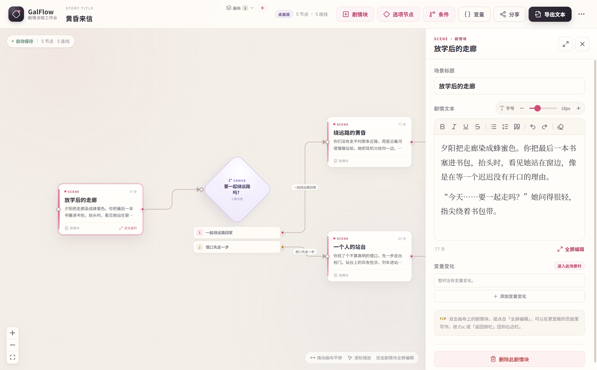
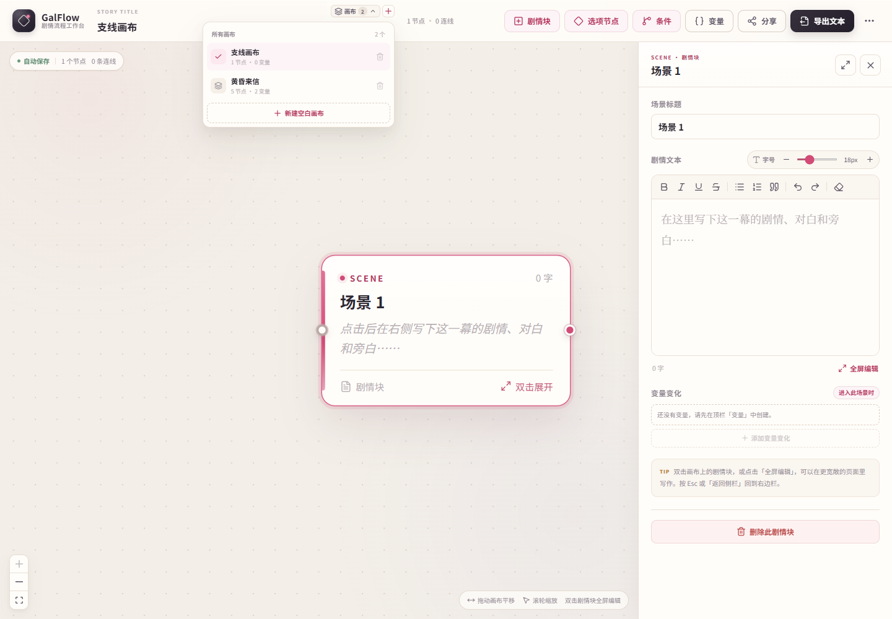
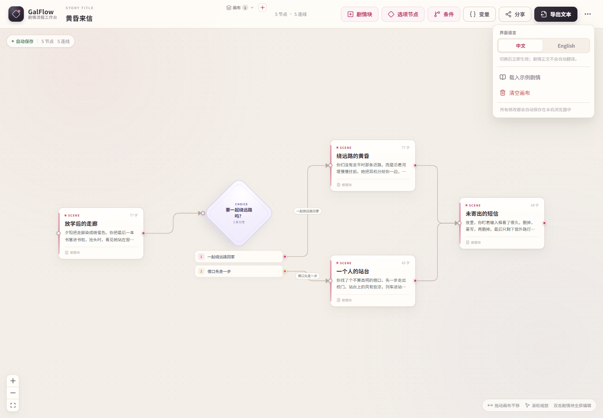
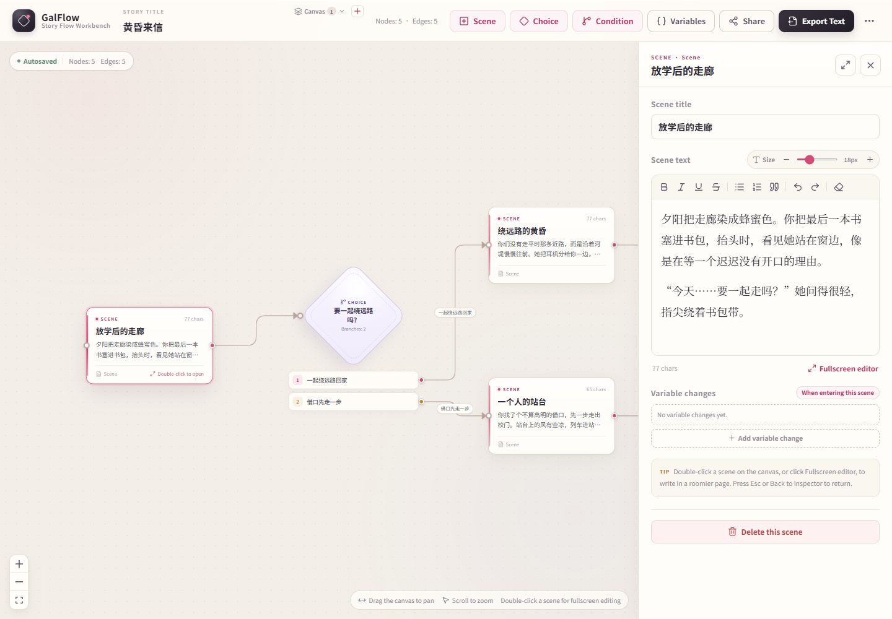
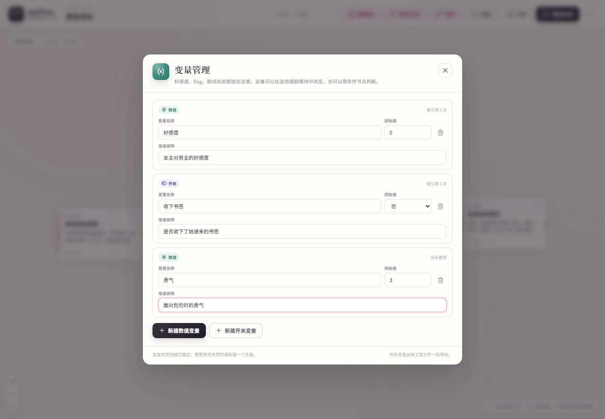
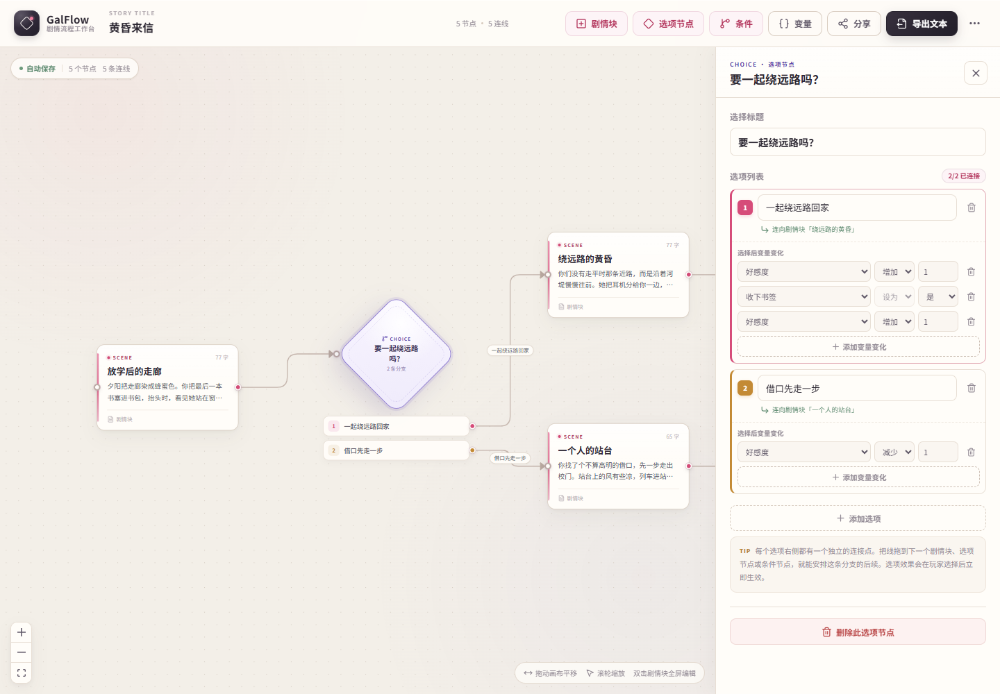
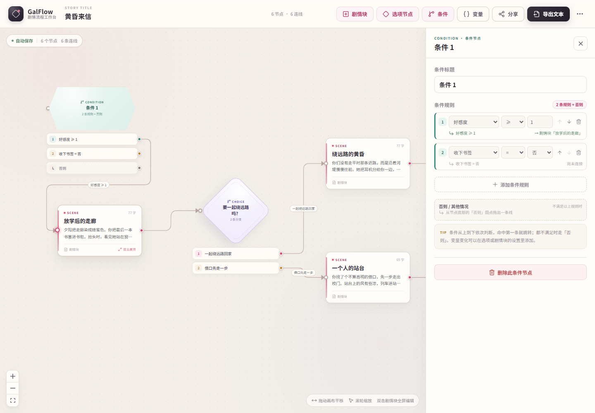
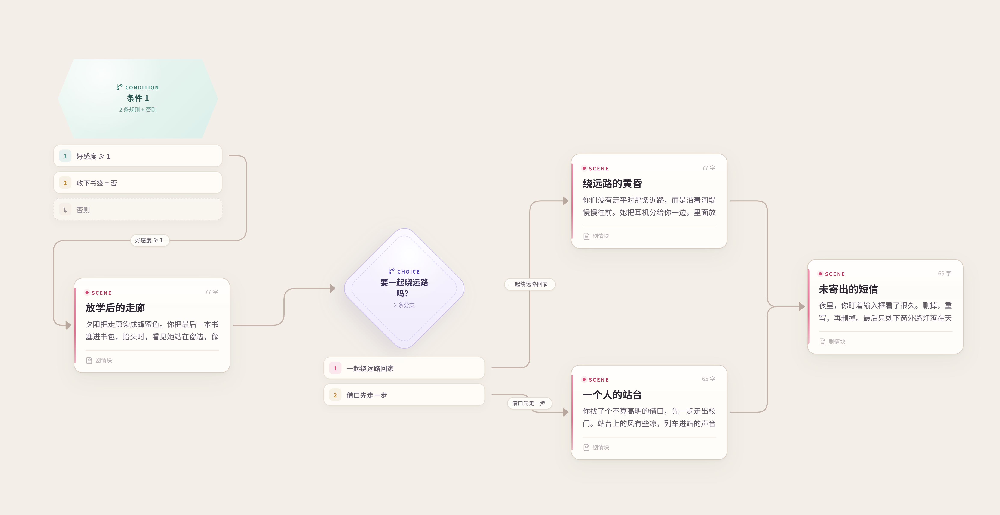
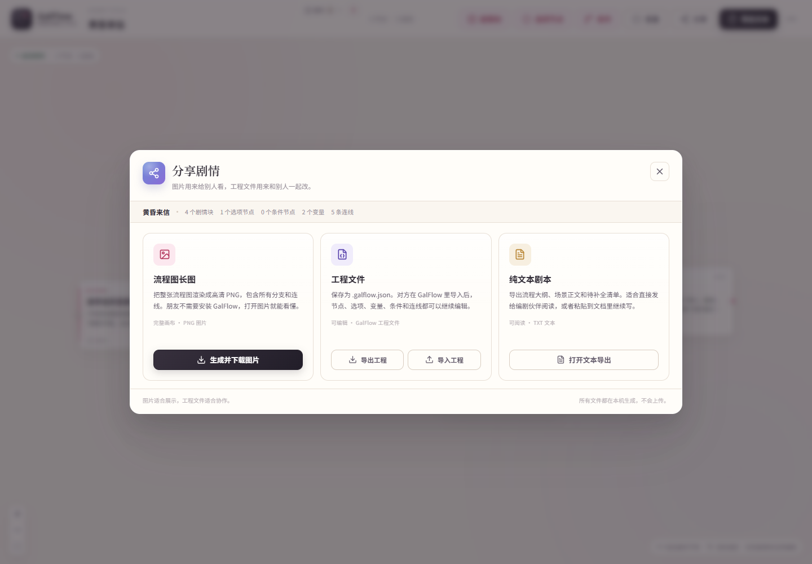
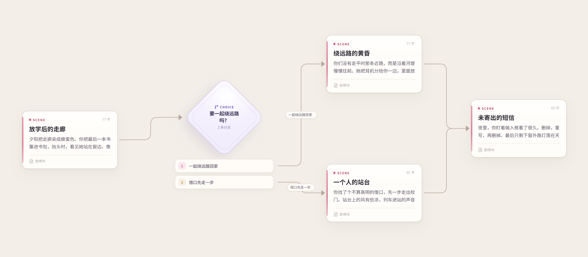

# GalFlow · Story Flow Workbench

**English** | [简体中文](README.zh-CN.md)

A visual story-flow editor for galgame / visual novel writing. Lay out scene blocks, choices, and variable-driven branches on a left-to-right canvas, then export a clean script whenever you need it.



## Why GalFlow

- **Write visually** — scenes are rectangles, choices are diamonds, and conditional branches are hexagons.
- **Keep the script readable** — rich-text scene content, automatic branch labels, and an export that reads like a real script document.
- **Model game state** — numeric variables (affection, money, progress) and boolean flags drive conditional routes.
- **Keep projects separate** — create multiple canvases, each with its own nodes, variables, and story content.
- **Everything stays local** — no account, server, or cloud dependency.

The app opens with a built-in sample story, **Letters at Dusk**, so a fresh clone is usable immediately. No personal project data is included in this repository.

## Features

- **Scene blocks** — edit title, rich-text content, and font size in the right inspector.
- **Choice nodes** — any number of options, each with its own connection handle and optional variable effects.
- **Condition nodes** — ordered rules with numeric/boolean comparisons and an `else` fallback.
- **Variables** — number and boolean variables, initial values, descriptions, usage counts, and cascade-safe deletion.
- **Multiple canvases** — create, switch, rename (via story title), and delete independent flowcharts. Switching restores content and fits the view.
- **Bilingual interface** — switch the UI and exported structural text between 中文 and English; the choice is saved locally.
- **Rich-text editor** — bold, italic, underline, strike-through, lists, quote, undo/redo, clear formatting, and 12–36 px text.
- **Fullscreen writing** — double-click a scene or use the inspector's fullscreen button.
- **Connections** — drag from a node handle to another node; option and condition edges get readable labels automatically.
- **Export & share** — full-flowchart PNG, versioned `.galflow.json` project files, and plain-text script export.
- **Autosave** — every canvas is persisted locally with versioned migrations for older data.
- **Desktop build** — Electron window with native save dialogs on Windows.

## Quick Start

Requirements: **Node.js 22+** (tested with Node 24).

```bash
git clone https://github.com/<your-username>/<your-repo>.git
cd <your-repo>
npm install
npm run dev
```

Open <http://127.0.0.1:5173/>.

On first launch, the built-in sample is loaded. Use the top-right menu to reload the sample or clear the current canvas.

### Production build

```bash
npm run build
npm run preview
```

## Windows Desktop

```bash
npm run desktop:build      # build release/GalFlow-win32-x64
npm run desktop         # build and launch with Electron
npm run desktop:install # install for the current user + desktop/Start menu shortcuts
npm run desktop:uninstall
```

- The desktop app is built with Electron 43 and `@electron/packager`.
- The app is not code-signed. Windows SmartScreen may warn on an unsigned build.
- Portable output is created at `release/GalFlow-win32-x64/`.
- `npm run desktop:pack` can build an optional NSIS installer if NSIS is available.

The browser version works on any platform supported by Vite; the desktop install scripts are Windows-specific.

## Multiple Canvases

Each canvas is an independent storyboard. Use the canvas control above the story title:

- **Create** with `+` or **New blank canvas** in the menu.
- **Switch** by selecting another canvas from the menu.
- **Rename** by editing the story title — the title is the canvas name.
- **Delete** from the menu. Deleting the active canvas switches to another one; the last remaining canvas cannot be deleted.
- Switching saves the current canvas and restores the target canvas. The viewport is fitted automatically.

Share/export operations apply to the **active canvas** only. Switch canvases and export each one separately when you need to share several.



## Interface Language

Open the top-right `...` menu and choose **中文** or **English** under **Language**.

- Changes take effect immediately and are saved locally.
- It translates the top bar, canvas hints, inspectors, variables, share/export dialogs, confirmation prompts, generated default node names, and exported structural headings/filenames.
- Your actual story text is **never machine-translated** — only the interface and generated scaffolding change.





## Variables and Conditional Branches

Open the `{}` **Variables** manager in the top bar.

- **Number variables** are useful for affection, money, or progress.
- **Boolean variables** are useful for flags such as "has the bookmark".
- Variables can be changed by **choice options** and **scene blocks**.
- A **condition node** evaluates rules from top to bottom; the first match wins, and `else` is the fallback.







Condition nodes and their branches are also included in exported PNGs:



## Sharing and Export

The **Share** dialog offers three local-only formats:

- **Flowchart PNG** — the complete graph with nodes, branches, edges, and labels. No GalFlow installation is needed to view it.
- **Project file (`.galflow.json`)** — complete editable data for another GalFlow user.
- **Plain-text script (`.txt`)** — outline, scene text, variable definitions, effects, condition rules, and endings.



Project imports are validated and sanitized: scene HTML is rebuilt with a strict allowlist and unknown fields are discarded.



## Your Data Stays Local

- Browser builds store projects in `localStorage`.
- Desktop builds store them under `%APPDATA%\GalFlow`.
- **No user project, exported flowchart, or project JSON is committed to this repository.**
- `.gitignore` excludes `.galflow.json`, exported text/images at the repository root, `.artifacts/`, `release/`, `dist/`, and personal story notes such as `gal.md`.
- Screenshots in `docs/` use the built-in sample story, not a personal project.
- If you add your own screenshots or sample projects, review `git status` before committing.

## Tech Stack

| Layer | Choice |
| --- | --- |
| UI | React 19 + TypeScript |
| Build | Vite 8 |
| Desktop | Electron 43 + `@electron/packager` |
| Flow canvas | `@xyflow/react` 12 |
| State | Zustand 5 + `persist` |
| Image export | `html-to-image` + React Flow viewport math |
| Project files | Versioned `.galflow.json` + strict HTML sanitizer |
| Icons | `lucide-react` |
| Tests | Vitest 4 + happy-dom, Playwright Core browser/Electron smoke tests |

Rich-text editing currently uses `contentEditable` + `document.execCommand`; it is intentionally lightweight and can be replaced with Tiptap/Lexical later without changing the story data model.

## Project Structure

```text
electron/               Electron main/preload processes
build/                  App icons and optional NSIS script
docs/                   README screenshots (sample content only)
scripts/                Desktop build/install and smoke tests
src/
  components/
    canvas/             React Flow canvas, nodes, edges
    editor/             Rich-text editor and fullscreen editor
    inspector/          Scene / choice / condition inspectors
    variables/          Variable manager and effects editor
    share/              PNG / project / text sharing dialog
    layout/             Top bar, canvas switcher, language menu
    export/             Text export dialog
  hooks/                Node creation helpers
  i18n/                 Chinese/English dictionaries and useI18n
  lib/                  Graph, variable, project, export and download helpers
  store/                Multi-canvas store, UI language store, migrations
  styles/               Area-specific CSS
  types/                Story, variable and canvas types
```

## Data Model

```ts
SceneNodeData     = { kind: 'scene', title, content, fontSize, effects }
ChoiceNodeData    = { kind: 'choice', title, options: { id, label, effects }[] }
ConditionNodeData = { kind: 'condition', title, cases: { variableId, operator, value }[] }
Variable          = { id, name, kind: 'number' | 'boolean', initialValue, description }
Effect            = { variableId, operation: 'add' | 'subtract' | 'set', value }
StoryCanvas       = { id, title, variables, nodes, edges, updatedAt }
```

Scene content is stored as HTML and converted to plain text on export. Edge `sourceHandle` values identify the exact option or condition rule, so a node can safely own many branches.

## Useful Commands

```bash
npm run dev
npm run build
npm run preview
npm run typecheck
npm run test
npm run smoke            # needs dev server + Edge/Chrome
npm run smoke:share
npm run smoke:variables
npm run smoke:canvases
npm run smoke:i18n       # Chinese/English switching
npm run smoke:desktop    # Electron smoke test
```

Smoke tests save screenshots under `.artifacts/` (ignored by Git).

## Known Limitations

- No undo/redo stack, multi-select, or copy/paste yet.
- No canvas duplication, ordering, search, or multi-canvas project export yet.
- No runtime "play through choices" simulator; variables are modelled for authoring and export.
- No AND/OR groups or variable range validation yet.
- No code signing, auto-update, or online read-only sharing.
- `contentEditable` behavior can vary between browsers.

## License

Released under the [MIT License](LICENSE).

Copyright (c) 2026 liverrr221.

---

**English** | [简体中文](README.zh-CN.md)
