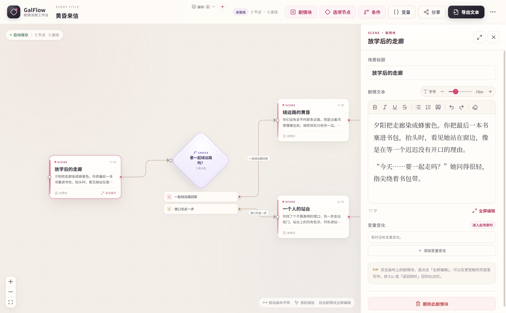
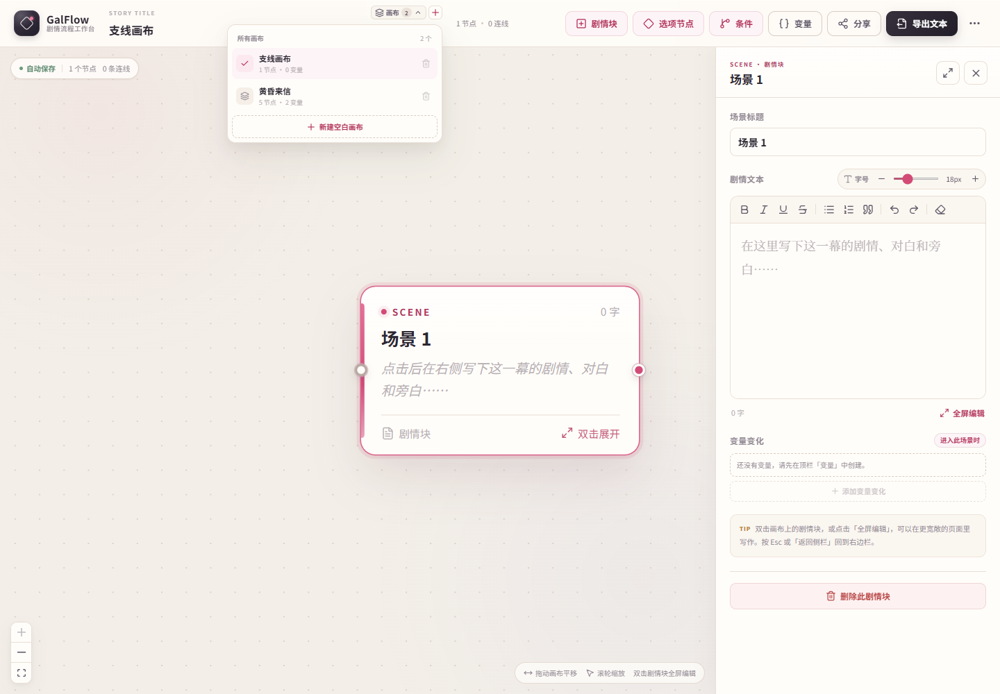
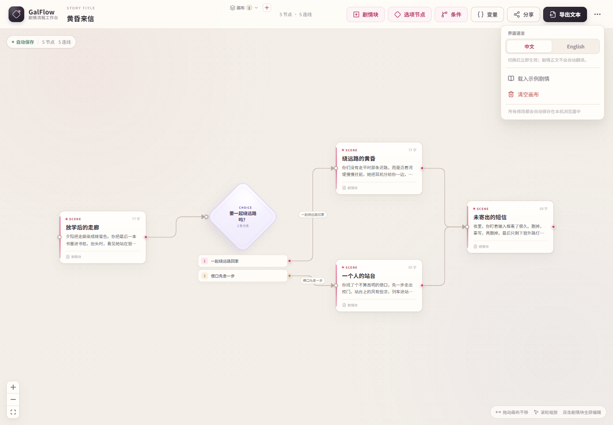
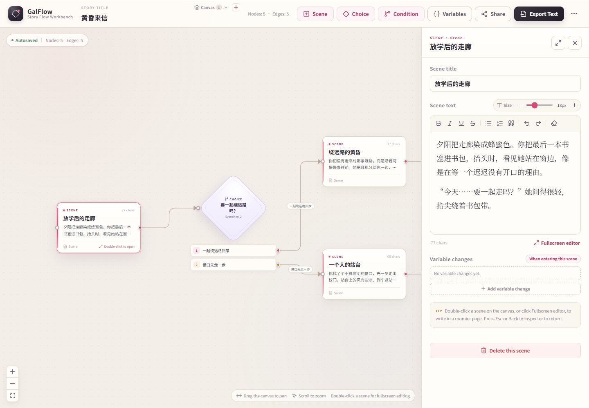
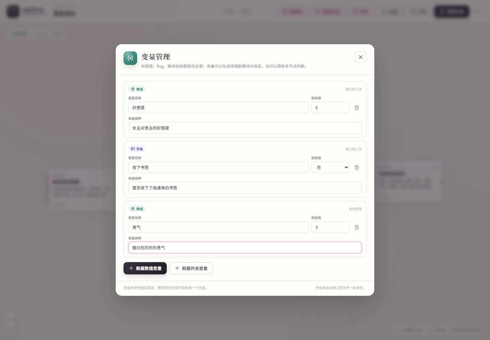
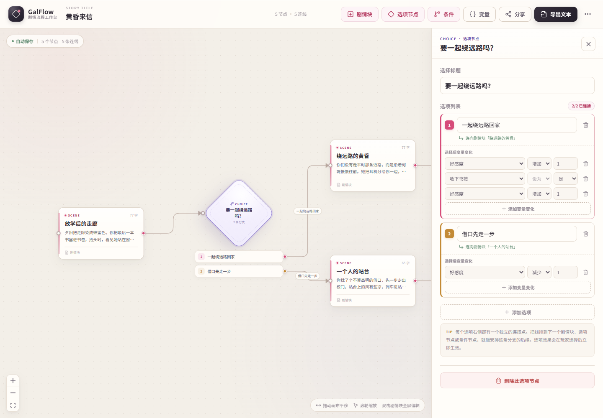
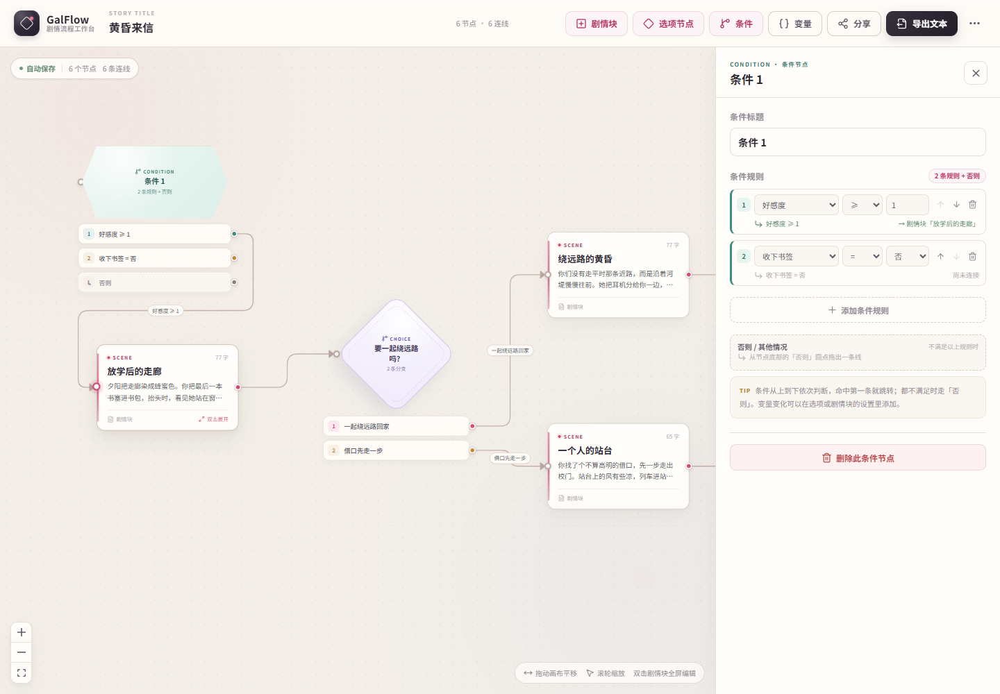
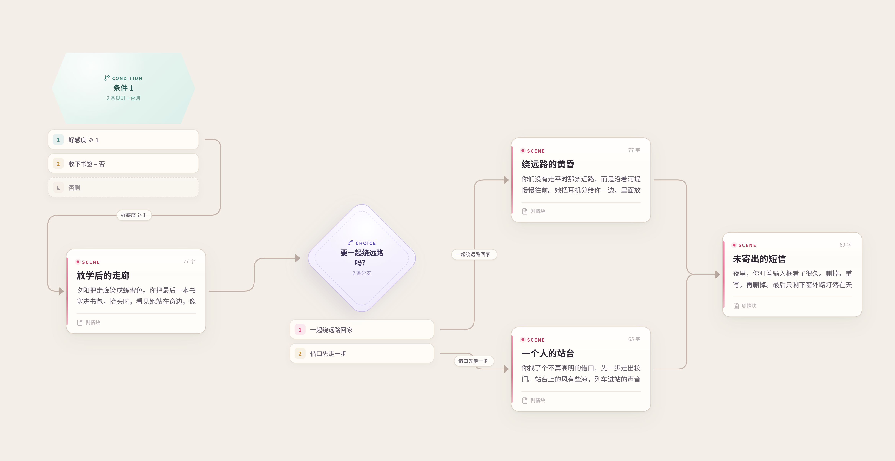
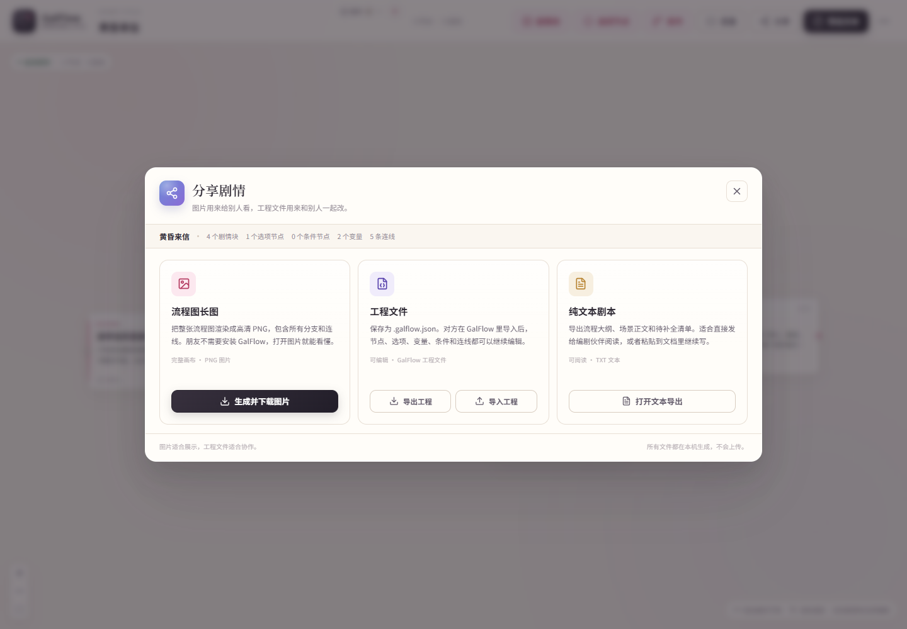
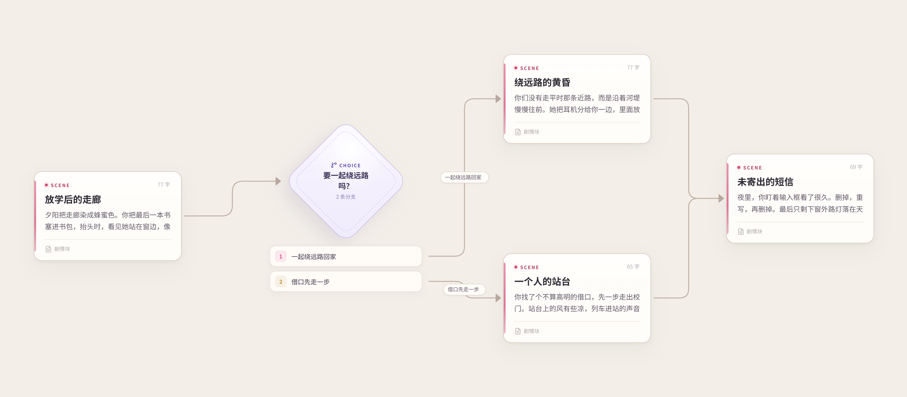

# GalFlow · 剧情流程工作台

[English](README.md) | **简体中文**

面向 galgame / 视觉小说编剧的可视化剧情流程编辑器。把剧情块、选项和变量条件分支铺在一张从左到右的画布上，需要时再整理成一份结构清晰的纯文本剧本。



## 为什么用 GalFlow

- **可视化写作**：剧情块是矩形，选项是菱形，条件分支是六边形。
- **导出仍然是剧本**：富文本正文、自动生成的选项/条件标签，以及按流程整理的文本稿。
- **可以表达游戏状态**：数值变量（好感度、金钱、进度）和开关变量共同决定后续路线。
- **项目互相独立**：可以创建多个画布，每个画布有自己的节点、变量和剧情。
- **全部数据在本机**：不需要账号、服务器或云服务。

首次打开会加载内置示例《黄昏来信》，所以刚克隆仓库的人也能直接上手。仓库中不包含任何个人剧情工程。

## 功能

- **剧情块**：在右侧编辑标题、富文本正文和字号。
- **选项节点**：任意多个选项，每个选项都有独立连接点和可选的变量效果。
- **条件节点**：按顺序判断数值/开关变量，命中第一条就走对应连线，都不满足时走「否则」。
- **变量系统**：数值变量与开关变量，支持初始值、用途说明、引用统计和安全删除。
- **多画布**：新建、切换、删除独立画布；画布标题就是剧情标题。切换时会恢复内容并自动适配视图。
- **中英文界面**：在设置菜单中切换中文 / English，选择会保存在本机；界面、提示、默认节点名和导出结构都会跟随语言。
- **富文本编辑**：加粗、斜体、下划线、删除线、列表、引用、撤销/重做、清除格式，以及 12–36px 字号。
- **全屏写作**：双击剧情块，或点击检查器的全屏按钮。
- **可视化连线**：从节点圆点拖到目标节点；选项和条件连线会自动显示可读标签。
- **导出与分享**：完整流程图 PNG、版本化 `.galflow.json` 工程文件、纯文本剧本。
- **自动保存**：每个画布都会保存到本机，旧版本数据会自动迁移。
- **Windows 桌面版**：Electron 独立窗口，导出时使用 Windows 原生保存对话框。

## 快速开始

要求：**Node.js 22+**（已在 Node 24 环境验证）。

```bash
git clone https://github.com/<你的用户名>/<仓库名>.git
cd <仓库名>
npm install
npm run dev
```

打开 <http://127.0.0.1:5173/>。

首次打开会自动加载内置示例。右上角菜单可以重新载入示例，或清空当前画布。

### 生产构建

```bash
npm run build
npm run preview
```

## Windows 桌面版

```bash
npm run desktop:build      # 生成 release/GalFlow-win32-x64
npm run desktop            # 构建并启动 Electron
npm run desktop:install    # 安装到当前用户 + 桌面/开始菜单快捷方式
npm run desktop:uninstall  # 卸载
```

- 桌面版使用 Electron 43 + `@electron/packager` 构建。
- 应用没有代码签名，Windows SmartScreen 可能提示未知发布者。
- 免安装版本位于 `release/GalFlow-win32-x64/`。
- 如果本机安装了 NSIS，可以用 `npm run desktop:pack` 生成可选的安装程序。

浏览器版可以在 Vite 支持的任何平台上运行；桌面安装脚本目前是 Windows 专用。

## 多画布

每个画布都是一个独立的剧情工程。标题上方的「画布」控件可以：

- **新建**：点击 `+`，或菜单中的「新建空白画布」。
- **切换**：在菜单中选择另一个画布。
- **重命名**：直接修改剧情标题，标题就是画布名称。
- **删除**：菜单中提供删除按钮。删除当前画布会自动切换到另一个画布；最后一个画布不能删除。
- 切换画布时会保存当前内容、恢复目标内容，并自动适配视图。

分享和导出只针对**当前画布**。要分享多个画布，请逐个切换后分别导出。



## 界面语言

打开右上角 `...` 菜单，在「界面语言」中选择 **中文** 或 **English**。

- 切换后立即生效，选择会保存在本机。
- 顶栏、画布提示、检查器、变量管理、分享/导出窗口、确认框、新建节点的默认名称，以及导出文本的结构性标题和文件名都会跟随语言。
- **剧情正文不会被自动翻译**，只会切换界面和自动生成的结构性文字。





## 变量与条件分支

点击顶栏的 `{}` 打开变量管理。

- **数值变量**：适合好感度、金钱、调查进度等。
- **开关变量**：适合 flag，例如是否收下书签、是否见过某人。
- 变量可以在**选项效果**和**剧情块效果**中改变。
- **条件节点**按从上到下的顺序判断，命中第一条就走对应分支，都不满足时走「否则」。







条件节点和条件连线也会包含在导出的 PNG 长图中：



## 分享与导出

「分享」窗口提供三种完全在本机生成的格式：

- **流程图 PNG**：包含节点、分支、连线和标签，对方不用安装 GalFlow 也能看。
- **工程文件（`.galflow.json`）**：完整可编辑数据，其他 GalFlow 用户可以继续修改。
- **纯文本剧本（`.txt`）**：流程大纲、场景正文、变量设定、选项/场景效果、条件规则和结局清单。



导入工程时会做校验和 HTML 白名单清理：只保留安全的排版标签，未知字段会被丢弃。



## 数据与隐私

- 浏览器版把工程保存在 `localStorage`。
- 桌面版把工程保存在 `%APPDATA%\GalFlow`。
- **仓库不包含任何个人剧情工程、导出流程图或工程 JSON。**
- `.gitignore` 已排除 `.galflow.json`、仓库根目录导出的文本/图片、`.artifacts/`、`release/`、`dist/`，以及 `gal.md` 这类个人剧情笔记。
- `docs/` 里的截图使用的是内置示例剧情，不是个人项目。
- 如果你自己添加截图或示例工程，提交前请先检查 `git status`。

## 技术栈

| 层次 | 选择 |
| --- | --- |
| UI | React 19 + TypeScript |
| 构建 | Vite 8 |
| 桌面 | Electron 43 + `@electron/packager` |
| 流程画布 | `@xyflow/react` 12 |
| 状态 | Zustand 5 + `persist` |
| 图片导出 | `html-to-image` + React Flow 视口计算 |
| 工程文件 | 版本化 `.galflow.json` + 严格 HTML 白名单清理 |
| 图标 | `lucide-react` |
| 测试 | Vitest 4 + happy-dom，Playwright Core 浏览器/Electron 冒烟测试 |

富文本编辑目前基于 `contentEditable` + `document.execCommand`，原型阶段足够轻量；以后可以替换成 Tiptap/Lexical，不影响剧情数据结构。

## 目录结构

```text
electron/               Electron 主进程与 preload
build/                  应用图标和可选 NSIS 脚本
docs/                   README 截图（只使用内置示例内容）
scripts/                桌面构建/安装与冒烟测试
src/
  components/
    canvas/             React Flow 画布、节点、连线
    editor/             富文本编辑器与全屏编辑
    inspector/          剧情块 / 选项 / 条件检查器
    variables/          变量管理与变量效果编辑器
    share/              PNG / 工程 / 文本分享窗口
    layout/             顶栏、多画布切换器与语言菜单
    export/             文本导出窗口
  hooks/                节点创建辅助
  i18n/                 中英文翻译表与 useI18n
  lib/                  图结构、变量、工程文件、导出与下载
  store/                多画布 store、界面语言 store 与迁移
  styles/               按区域拆分的样式
  types/                剧情、变量、画布类型
```

## 数据结构

```ts
SceneNodeData     = { kind: 'scene', title, content, fontSize, effects }
ChoiceNodeData    = { kind: 'choice', title, options: { id, label, effects }[] }
ConditionNodeData = { kind: 'condition', title, cases: { variableId, operator, value }[] }
Variable          = { id, name, kind: 'number' | 'boolean', initialValue, description }
Effect            = { variableId, operation: 'add' | 'subtract' | 'set', value }
StoryCanvas       = { id, title, variables, nodes, edges, updatedAt }
```

剧情正文保存为 HTML，导出时统一转换成纯文本。连线的 `sourceHandle` 会指向具体选项或条件规则，因此一个节点可以安全地拥有多条分支。

## 常用命令

```bash
npm run dev
npm run build
npm run preview
npm run typecheck
npm run test
npm run smoke            # 需要先启动 dev server，并安装 Edge/Chrome
npm run smoke:share
npm run smoke:variables
npm run smoke:canvases
npm run smoke:i18n       # 中英文界面切换
npm run smoke:desktop    # Electron 冒烟测试
```

冒烟测试的截图会写入 `.artifacts/`，该目录已被 Git 忽略。

## 已知限制

- 暂无撤销/重做栈、多选和复制粘贴。
- 暂无画布复制、排序、搜索和多画布整体导入导出。
- 暂无“点选项试玩并实时计算变量”的运行时模拟器；当前变量用于创作和导出。
- 暂不支持多条件 AND/OR 组合和变量范围校验。
- 暂无代码签名、自动更新和在线只读分享。
- `contentEditable` 的编辑行为在不同浏览器中可能略有差异。

## 许可证

本项目采用 [MIT 许可证](LICENSE)。

Copyright (c) 2026 liverrr221。

---

[English](README.md) | **简体中文**
